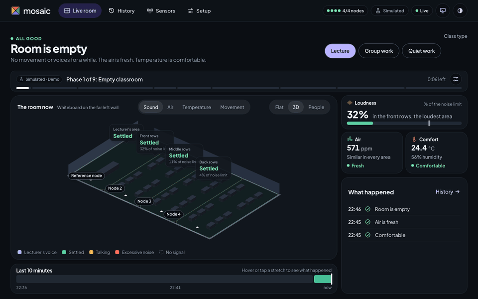
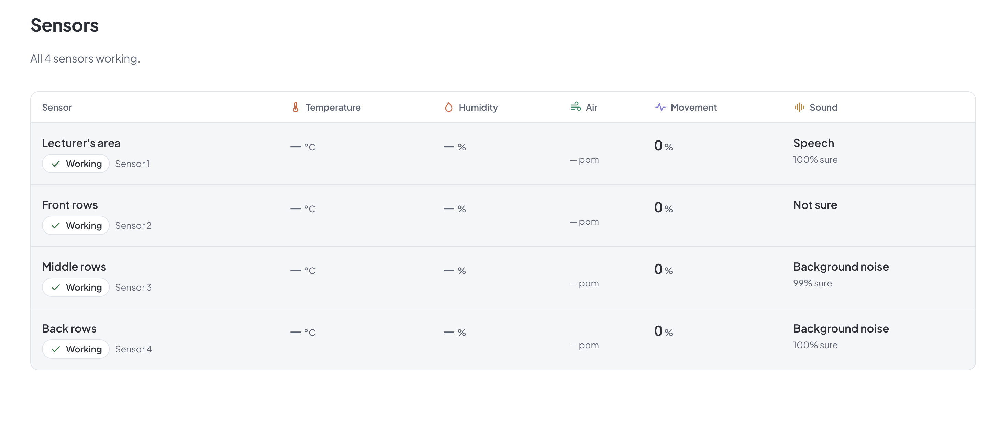
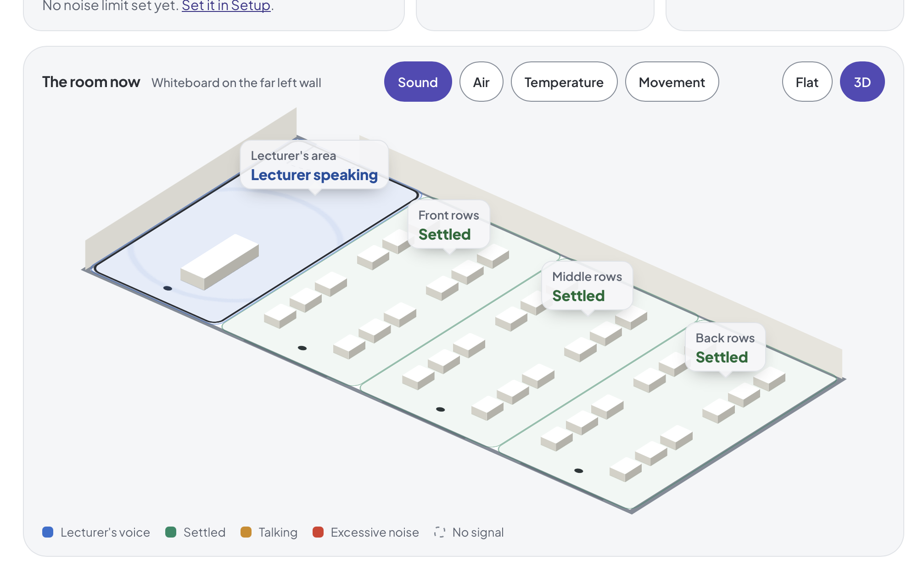
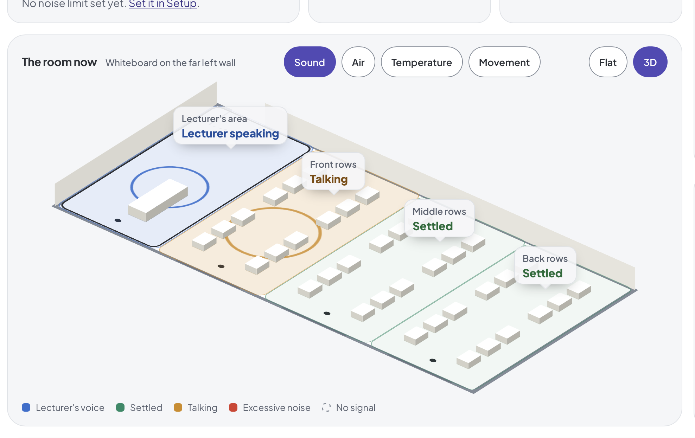
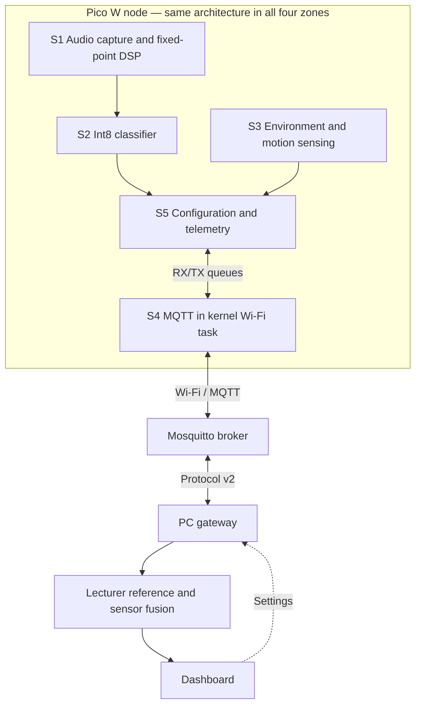

# MOSAIC — Classroom Monitoring System

**Multimodal Observation and Sensor-fusion Architecture for Intelligent Classrooms**

INF2004 Embedded Systems · Team CSC21

Four Raspberry Pi Pico W nodes listen to a classroom and measure its air. Each node
runs dual-core **µT-Kernel 3.0**, turns sound into features and a label **on the
chip, with integer arithmetic only**, and sends 64-byte reports over **MQTT**. A PC
compares the four zones with each other and shows the room on a live dashboard: who
is talking and where, whether the air is getting stuffy, and whether it's
comfortable. No audio ever leaves a node.



*The dashboard playing the scripted demo, one frame per phase. These are simulated
nodes; real-node screenshots are [below](#real-nodes).*

## Try it in two minutes, no hardware

The dashboard, gateway, fusion engine and node simulator use only Python's standard
library: there is nothing to install. You need Python 3.12 or newer (tested on 3.12
and 3.14).

```sh
git clone https://github.com/yuzhihao1212/INF2004_CSC21_Embedded.git
cd INF2004_CSC21_Embedded/pc
python3 -m mosaic.dashboard --scenario demo
```

Open <http://localhost:8050>. Four simulated nodes play a scripted 20-minute lesson;
the bar under the headline names each phase. Press **→** to skip to the next phase,
**Space** to pause and **1**, **2** or **4** to change the speed. Each change takes
10 to 60 seconds to show, because the system waits for a state to hold before
announcing it.

| Phase | What the dashboard should show |
|---|---|
| Empty classroom | Room is empty |
| Lecturer teaching, students seated | Lecture in progress; only the lecturer's area shows the lecturer's voice |
| Rear students start chatting | Getting noisy, then Ongoing chatter with an alert card |
| Back rows get rowdy | Excessive noise in the middle and back rows, with an alert card |
| Class settles down | Lecture in progress again |
| Door and windows closed: CO₂ builds up | The air is stuffy, with an alert to open a door or window |
| Window opened | Air: Fresh again |
| Air-conditioning fails | Comfort: too warm, too humid |
| Air-conditioning restored | Comfortable |

Also worth a look:

- **Setup** changes the class type: switch to *Group work* and the same chatter no
  longer raises an alert.
- **Sensors** shows each node's readings, signal, lost reports and response time.
- `python3 -m mosaic.dashboard --scenario reference` shows the lecturer-reference
  comparison: click **Calibrate** in Setup › Voice setup during the first phase.
- `python3 -m unittest` in `pc/` runs the 305 PC tests, and
  `node/testing/run_host_tests.sh` compiles and tests the node's C code on your
  computer.

Don't run `pip install -r requirements.txt` for this: those packages are only for
retraining the audio model in `ml/`.

## What's inside

- **A real-time OS on both cores.** The node runs µT-Kernel 3.0 on both RP2040
  cores: audio DSP on core 0, the classifier on core 1, sensors, reporting and a
  progress supervisor beside them. Tasks share data only through kernel objects.
- **Integer-only signal processing and TinyML.** Every 500 ms the node captures
  8,000 samples by DMA, runs a Q15 FFT and MFCCs, and classifies the window with an
  int8 neural network (368 bytes of weights). No floating point anywhere
  ([number formats](docs/audio_numeric_representation.md)).
- **A compact protocol.** Each report is 64 bytes, published on MQTT through the
  kernel's own lwIP client. Settings go back to the nodes as retained messages and
  are acknowledged once applied.
- **Fusion that knows where the lecturer is.** One node sits at the lecturer's
  desk. The PC learns how loud the lecturer sounds at every other node, so students
  talking can be told apart from the lecturer's voice carrying.
- **It fails per zone, not as a whole.** An invalid reading or a silent node shows
  as missing in that zone only (*No signal*, *Not connected* or *No reading*), never
  as an old value, while the other zones keep working.

<a id="real-nodes"></a>

## On real hardware

| Four nodes online | Lecturer only | Student talking at Node 2 |
|---|---|---|
|  |  |  |

Four Pico W nodes in a room, 20 November 2026. The final demonstration on
25 November ran on the same set-up. What was tested on hardware, on the PC, and not
at all is set out under [What was and was not tested](#what-was-and-was-not-tested).

## Architecture



Zone A (node 1) is the lecturer reference. Nodes 2–4 cover the student zones B–D.
Microphone samples stay on the node during normal operation. Telemetry carries
classification, sensor readings, validity and timing information.

### Why fusion runs on the PC, not on a Pico

The work is split by what each decision needs. Anything that needs only one
zone's sensors runs **on that zone's Pico**: sampling, DSP, the int8 classifier,
the clipping and low-level gates, the two-window speech rule and sensor
validity. Anything that compares zones runs **on the PC**: telling students
talking from the lecturer's voice carrying, the room-level state, the class-type
rules and the dwell timers.

Fusion could run on a Pico; its arithmetic is already integer-only and small.
We kept the cross-zone part on the PC for these reasons:

1. **It needs every node's data.** Whether Node 3 is "students talking" or "the
   lecturer heard from the back" depends on the reference node at the lecturer's
   desk. No single Pico has the other nodes' readings.
2. **MQTT is a star.** Nodes never talk to each other; every message goes through
   the broker on the PC. A Pico doing fusion would get its data from the PC and
   send results back to it: an extra hop, with the dashboard still on the PC.
3. **One failure would take the whole room.** With fusion on the PC, a failed
   node only blanks its own zone. A Pico doing fusion for everyone would blank
   all four zones whenever it failed.
4. **One clock.** The lecturer comparison pairs windows from two nodes to within
   250 ms. The Picos' clocks aren't synchronised; the PC stamps every report with
   its own clock on arrival.
5. **It stays inside the course template's rules.** Application tasks may not
   call MQTT. A Pico doing fusion would have to subscribe to the other nodes'
   topics inside the kernel's shared Wi-Fi task, which needs the instructor's
   agreement to change.
6. **It can be tuned and tested without reflashing.** Thresholds, the class type,
   calibration and loud levels change from the dashboard, and the fusion engine
   runs against the simulator and 305 tests with no hardware.

What we would move to the node with more time: each zone's own smoothing over
10 seconds, which needs no other zone and would cut the PC's work per report.

### How the room's state is decided

In short, the dashboard is the end of a three-step chain:

1. **Each Pico labels its own sound** every 500 ms as background, speech or a
   transient noise, and leaves it UNKNOWN when the window is too quiet, clipped,
   late or not confident. Speech needs two windows in a row.
2. **The PC decides each zone's state** from its last 10 seconds, first rule
   wins: *No signal* → *Excessive noise* (above the limit set in Setup) →
   *Lecturer's voice* (the reference zone) → *Talking* → *Moving around* (PIR) →
   *Settled*. A student zone counts as *Talking* only when it is louder than the
   lecturer's voice is expected to be at that desk, learned during voice set-up.
3. **The PC decides the room's state** from all the zones and the class type:
   *Lecture in progress* when only the lecturer speaks, *Getting noisy* and then
   *Ongoing chatter* when students talk during a lecture, *Group discussion* when
   at least half the groups talk in group work, and *Room is empty* after 10
   minutes with no movement or voices. Air and comfort follow CO₂, temperature
   and humidity thresholds.

Every state has to hold for a set time (10 s per zone, 20 s for the room, 60 s
for air and comfort) before the dashboard changes, so a single cough or reading
doesn't flip it. Missing data shows as missing, never as the last value.
[How MOSAIC decides what the room is doing](docs/room-states.md) starts from the
64-byte report (what each field is for, and why the packet is shaped that way),
then gives every rule and threshold, and how urgent each state is in each class type.

## Important code

| Owner / component | Start here | Responsibility |
| --- | --- | --- |
| Moe (S1) | [task_audio.c](node/app_program/subsystem1/task_audio.c), [drv_audio.c](node/app_program/subsystem1/drv_audio.c), [audio_dsp.c](node/app_program/subsystem1/audio_dsp.c) | ADC/DMA capture at 16 kHz, 500 ms windows, integer-only feature extraction |
| Darius (S2) | [task_classifier.c](node/app_program/subsystem2/task_classifier.c), [audio_inference.c](node/app_program/subsystem2/audio_inference.c) | Int8 inference, confidence and speech persistence |
| Kendrick (S3) | [task_environment.c](node/app_program/subsystem3/task_environment.c), [environment_service.c](node/app_program/subsystem3/environment_service.c) | DHT22, ACD1100 CO₂, PIR, validity and recovery |
| Arif (S4) | [s4_network.c](node/app_program/subsystem4/s4_network.c), [mqtt_utk.c](node/lib/liblwip/sysdepend/pico_rp2040/mqtt_utk.c), [s4_health.c](node/app_program/subsystem4/s4_health.c) | Non-blocking queue bridge to MQTT inside the kernel Wi-Fi task; supervisor task that checks the other tasks keep making progress. The hardware watchdog it can feed is built but switched off |
| ZhiHao (S5) | [task_report.c](node/app_program/subsystem5/task_report.c), [s5_protocol.c](node/app_program/subsystem5/s5_protocol.c) | CONFIG validation, telemetry and control messages |
| ZhiHao (PC gateway) | [gateway.py](pc/mosaic/gateway.py), [mqtt.py](pc/mosaic/mqtt.py) | Packet reception, node tracking and configuration delivery |
| ZhiHao (PC fusion) | [fusion.py](pc/mosaic/fusion.py), [reference.py](pc/mosaic/reference.py) | Classroom and zone states; lecturer-reference comparison |
| ZhiHao (dashboard) | [dashboard.py](pc/mosaic/dashboard.py), [app.js](pc/mosaic/web/app.js) | HTTP API, live room, history, sensors and setup |

Node startup is in [app_main.c](node/app_program/app_main.c). The C and Python wire
definitions are [mosaic_protocol.h](firmware/common/include/mosaic_protocol.h) and
[protocol.py](pc/mosaic/protocol.py). [TEAM.md](node/TEAM.md) lists pin assignments,
resource ownership and inter-subsystem interfaces.

## Build and run the real system

### 1. Build the Pico W firmware

Install the Arm GNU toolchain, make and Pico SDK 2.2.0 (2.3.0 also tested) using
the [node setup guide](node/README.md). On Windows use WSL for this make build.
In the SDK checkout initialise the required submodules:

```sh
git submodule update --init lib/tinyusb lib/cyw43-driver lib/lwip
```

From the MOSAIC repository, create these files on first setup only (keep existing local settings):

```sh
cp node/config/wifi_secrets.example.h node/config/wifi_secrets.h
cp node/app_program/subsystem5/s5_node_id.example.h node/app_program/subsystem5/s5_node_id.h
```

Edit the local Wi-Fi header to set the network name/password and the PC's LAN
address in MQTT_BROKER_IP. These local config files are ignored by Git.
Set MOSAIC_NODE_ID in the identity header to 1, 2, 3 or 4, one value per Pico.

```sh
cd node/build_make
make NET=lwip MQTT=1 -j8
```

The image is `mtk3pico_smp1_usb_cdc_wifi_lwip_mqtt.uf2`. Save a copy for each
node before changing the ID and rebuilding. If changing the ID does not trigger a
recompile, use the build's clean target and rebuild that profile. Flash via BOOTSEL.
Use the USB console at 115200 baud to observe startup and connection status.

For on-target self-tests, use the same network profile with `TEST=1`.
Keep normal demo and test images separate.

### 2. Start Mosquitto

Run the MQTT broker on the PC and put the PC and Picos on the same local network.
The Pico's broker address must be reachable from that network. Use the broker's
local installation and a listener on the PC's LAN interface, port 1883, with
access configured for the nodes and PC. For an isolated development hotspot the prototype uses a local Mosquitto
configuration file such as the following, saved outside the repository:

~~~conf
listener 1883 0.0.0.0
allow_anonymous true
~~~

Start it with `mosquitto -c <path-to-local-config> -v`. Restrict this setup to
the trusted test network. See [wire protocol](docs/protocol.md) for topics and QoS.

### 3. Run the dashboard

Python's standard library is sufficient for the dashboard and gateway. From the
repository root:

```sh
cd pc
python -m mosaic.dashboard --mqtt localhost --csv telemetry.csv --events events.jsonl
```

Open http://localhost:8050. Verify that each real node reports under its assigned
ID, then calibrate Zone A with only the lecturer speaking. Check sensors and
configuration delivery in the dashboard. See the [PC guide](pc/README.md) for
configuration, reference calibration, logs and evaluation.

To rehearse without hardware, stop the live dashboard and run:

```sh
python -m mosaic.dashboard --scenario demo
```

This is explicitly simulated data.

## Repository guide

| Directory | Role in final submission |
| --- | --- |
| [node/](node/README.md) | Deployed µT-Kernel firmware, course kernel and all five subsystems |
| [pc/](pc/README.md) | Gateway, fusion, dashboard, simulator and evaluation tools |
| [firmware/](firmware/README.md) | Earlier firmware, standalone tests, shared C protocol and model/DSP dependencies |
| [ml/](ml/README.md) | Training datasets, preprocessing and model generation; training runs on the PC |
| [docs/](docs/README.md) | Requirements, engineering decisions, test evidence and assessment index |
| [node/testing/](node/testing/README.md) | Test definitions, logs and integration evidence |

The course template contains example LED/producer/consumer/monitor tasks that
remain referenced by the current build and tests. The earlier CMake code also
contains shared data definitions, model headers, host baselines and CI targets.
See the [reference firmware guide](firmware/README.md) before removing any of it.

### What is needed at runtime

- Build and flash the firmware from `node/`, including the course kernel,
  the five application subsystems and their shared `firmware/` dependencies.
- Run `pc/mosaic/` and the Mosquitto broker on the PC.
- Keep `node/testing/`, `docs/`, the standalone firmware targets and `ml/` in
  the submission for reproducibility, assessment evidence and provenance.
  The training tools and standalone demo binaries do not run in the deployed system.
- Local build output, temporary logs, private Wi-Fi configuration, virtual
  environments and Python bytecode can be regenerated. Do not commit these;
  retain deliberate, dated test evidence in the test/evidence directories.

## Verification and submission

- [Assessment and evidence index](docs/README.md)
- [CSC21 fixed-point / integer TinyML requirement](docs/change_requirement_csc21.md)
- [Four-node hardware observations](node/testing/integration/logs/2026-11-20-four-node-session.md)
- [Audio investigation and timing limitations](node/testing/integration/logs/2026-11-20-audio-investigation.md)
- [Sensor hardware procedure](node/testing/subsystem3/HARDWARE_EVIDENCE.md)
- [Test record rules](node/testing/README.md)
- [System tests: the final demo](node/testing/system/TEST_LOG.md)
- [Audio and classifier number formats](docs/audio_numeric_representation.md)

Run the PC tests from `pc/` using `python -m unittest -v`. Rerun every host test
of the node code with `node/testing/run_host_tests.sh`: it needs only a C
compiler and Python.

### What was and was not tested

- **On hardware.** The final demo on 25 November ran five scenarios on four
  Picos: they mostly behaved as expected, with some inconsistent results. Nobody
  recorded it. The 20 November session recorded real audio telemetry from four
  Picos, with no valid temperature, humidity or CO₂ at the dashboard.
- **On the PC.** The DSP, classifier, sensor decoding, CONFIG handling, gateway
  and fusion are covered by host and unit tests, recorded against the hand-in code.
- **Not tested.** The watchdog (switched off), recovery from a broker or Wi-Fi
  outage, the environment sensors end to end, and the DSP deadline on a board.
  The node's audio clock counts once per 42.67 µs, not once per microsecond, so
  its logged `_us` times are 42.67 times too small; this is documented in
  `drv_audio.c` and was left as it ran in the demo.
- The hardware was returned after the final demo, so no further board tests
  are possible.

Read [CONTRIBUTING.md](CONTRIBUTING.md) for the team PR workflow.
