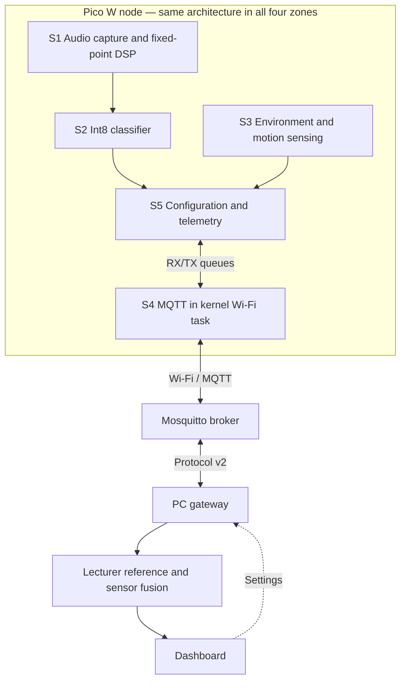

# MOSAIC — Classroom Monitoring System

**INF2004 Embedded Systems | CSC21**

MOSAIC monitors classroom activity, ventilation and comfort using four Raspberry Pi
Pico W sensing nodes. Each node runs dual-core µT-Kernel 3.0 and sends processed
sensor readings and audio classifications to a central PC over MQTT. The PC combines
the zone readings and presents them on a web dashboard.


## Architecture



Zone A (node 1) is the lecturer reference. Nodes 2–4 cover the student zones B–D.
Microphone samples stay on the node during normal operation. Telemetry carries
classification, sensor readings, validity and timing information.

## Important code

| Owner / component | Start here | Responsibility |
| --- | --- | --- |
| Moe (S1) | [task_audio.c](node/app_program/subsystem1/task_audio.c), [drv_audio.c](node/app_program/subsystem1/drv_audio.c), [audio_dsp.c](node/app_program/subsystem1/audio_dsp.c) | ADC/DMA capture at 16 kHz, 500 ms windows, integer-only feature extraction |
| Darius (S2) | [task_classifier.c](node/app_program/subsystem2/task_classifier.c), [audio_inference.c](node/app_program/subsystem2/audio_inference.c) | Int8 inference, confidence and speech persistence |
| Kendrick (S3) | [task_environment.c](node/app_program/subsystem3/task_environment.c), [environment_service.c](node/app_program/subsystem3/environment_service.c) | DHT22, ACD1100 CO₂, PIR, validity and recovery |
| Arif (S4) | [s4_network.c](node/app_program/subsystem4/s4_network.c), [mqtt_utk.c](node/lib/liblwip/sysdepend/pico_rp2040/mqtt_utk.c), [s4_health.c](node/app_program/subsystem4/s4_health.c) | Non-blocking queue bridge to MQTT inside the kernel Wi-Fi task; supervisor task that checks the other tasks keep making progress. The hardware watchdog it can feed is built but switched off |
| ZhiHao (S5) | [task_report.c](node/app_program/subsystem5/task_report.c), [s5_protocol.c](node/app_program/subsystem5/s5_protocol.c) | CONFIG validation, telemetry and control messages |
| PC gateway | [gateway.py](pc/mosaic/gateway.py), [mqtt.py](pc/mosaic/mqtt.py) | Packet reception, node tracking and configuration delivery |
| PC fusion | [fusion.py](pc/mosaic/fusion.py), [reference.py](pc/mosaic/reference.py) | Classroom and zone states; lecturer-reference comparison |
| Dashboard | [dashboard.py](pc/mosaic/dashboard.py), [app.js](pc/mosaic/web/app.js) | HTTP API, live room, history, sensors and setup |

Node startup is in [app_main.c](node/app_program/app_main.c). The C and Python wire
definitions are [mosaic_protocol.h](firmware/common/include/mosaic_protocol.h) and
[protocol.py](pc/mosaic/protocol.py). [TEAM.md](node/TEAM.md) lists pin assignments,
resource ownership and inter-subsystem interfaces.

## Build and run the real system

### 1. Build the Pico W firmware

Install the Arm GNU toolchain, make and Pico SDK 2.2.0 (2.3.0 also tested) using
the [node setup guide](node/README.md). On Windows use WSL for this make build.
In the SDK checkout initialise the required submodules:

```sh
git submodule update --init lib/tinyusb lib/cyw43-driver lib/lwip
```

From the MOSAIC repository, create these files on first setup only (keep existing local settings):

```sh
cp node/config/wifi_secrets.example.h node/config/wifi_secrets.h
cp node/app_program/subsystem5/s5_node_id.example.h node/app_program/subsystem5/s5_node_id.h
```

Edit the local Wi-Fi header to set the network name/password and the PC's LAN
address in MQTT_BROKER_IP. These local config files are ignored by Git.
Set MOSAIC_NODE_ID in the identity header to 1, 2, 3 or 4, one value per Pico.

```sh
cd node/build_make
make NET=lwip MQTT=1 -j8
```

The image is `mtk3pico_smp1_usb_cdc_wifi_lwip_mqtt.uf2`. Save a copy for each
node before changing the ID and rebuilding. If changing the ID does not trigger a
recompile, use the build's clean target and rebuild that profile. Flash via BOOTSEL.
Use the USB console at 115200 baud to observe startup and connection status.

For on-target self-tests, use the same network profile with `TEST=1`.
Keep normal demo and test images separate.

### 2. Start Mosquitto

Run the MQTT broker on the PC and put the PC and Picos on the same local network.
The Pico's broker address must be reachable from that network. Use the broker's
local installation and a listener on the PC's LAN interface, port 1883, with
access configured for the nodes and PC. For an isolated development hotspot the prototype uses a local Mosquitto
configuration file such as the following, saved outside the repository:

~~~conf
listener 1883 0.0.0.0
allow_anonymous true
~~~

Start it with `mosquitto -c <path-to-local-config> -v`. Restrict this setup to
the trusted test network. See [wire protocol](docs/protocol.md) for topics and QoS.

### 3. Run the dashboard

Python's standard library is sufficient for the dashboard and gateway. From the
repository root:

```sh
cd pc
python -m mosaic.dashboard --mqtt localhost --csv telemetry.csv --events events.jsonl
```

Open http://localhost:8050. Verify that each real node reports under its assigned
ID, then calibrate Zone A with only the lecturer speaking. Check sensors and
configuration delivery in the dashboard. See the [PC guide](pc/README.md) for
configuration, reference calibration, logs and evaluation.

To rehearse without hardware, stop the live dashboard and run:

```sh
python -m mosaic.dashboard --scenario demo
```

This is explicitly simulated data.

## Repository guide

| Directory | Role in final submission |
| --- | --- |
| [node/](node/README.md) | Deployed µT-Kernel firmware, course kernel and all five subsystems |
| [pc/](pc/README.md) | Gateway, fusion, dashboard, simulator and evaluation tools |
| [firmware/](firmware/README.md) | Earlier firmware, standalone tests, shared C protocol and model/DSP dependencies |
| [ml/](ml/README.md) | Training datasets, preprocessing and model generation; training runs on the PC |
| [docs/](docs/README.md) | Requirements, engineering decisions, test evidence and assessment index |
| [node/testing/](node/testing/README.md) | Test definitions, logs and integration evidence |

The course template contains example LED/producer/consumer/monitor tasks that
remain referenced by the current build and tests. The earlier CMake code also
contains shared data definitions, model headers, host baselines and CI targets.
See the [reference firmware guide](firmware/README.md) before removing any of it.

### What is needed at runtime

- Build and flash the firmware from `node/`, including the course kernel,
  the five application subsystems and their shared `firmware/` dependencies.
- Run `pc/mosaic/` and the Mosquitto broker on the PC.
- Keep `node/testing/`, `docs/`, the standalone firmware targets and `ml/` in
  the submission for reproducibility, assessment evidence and provenance.
  The training tools and standalone demo binaries do not run in the deployed system.
- Local build output, temporary logs, private Wi-Fi configuration, virtual
  environments and Python bytecode can be regenerated. Do not commit these;
  retain deliberate, dated test evidence in the test/evidence directories.

## Verification and submission

- [Assessment and evidence index](docs/README.md)
- [CSC21 fixed-point / integer TinyML requirement](docs/change_requirement_csc21.md)
- [Four-node hardware observations](node/testing/integration/logs/2026-11-20-four-node-session.md)
- [Audio investigation and timing limitations](node/testing/integration/logs/2026-11-20-audio-investigation.md)
- [Sensor hardware procedure](node/testing/subsystem3/HARDWARE_EVIDENCE.md)
- [Test record rules](node/testing/README.md)
- [System tests: the final demo](node/testing/system/TEST_LOG.md)
- [Audio and classifier number formats](docs/audio_numeric_representation.md)

Run the PC tests from `pc/` using `python -m unittest -v`. Rerun every host test
of the node code with `node/testing/run_host_tests.sh`: it needs only a C
compiler and Python.

### What was and was not tested

- **On hardware.** The final demo on 25 November ran five scenarios on four
  Picos: they mostly behaved as expected, with some inconsistent results. Nobody
  recorded it. The 20 November session recorded real audio telemetry from four
  Picos, with no valid temperature, humidity or CO₂ at the dashboard.
- **On the PC.** The DSP, classifier, sensor decoding, CONFIG handling, gateway
  and fusion are covered by host and unit tests, recorded against the hand-in code.
- **Not tested.** The watchdog (switched off), recovery from a broker or Wi-Fi
  outage, the environment sensors end to end, and the DSP deadline on a board.
  The node's audio clock counts once per 42.67 µs, not once per microsecond, so
  its logged `_us` times are 42.67 times too small; this is documented in
  `drv_audio.c` and was left as it ran in the demo.
- The hardware was returned after the final demo, so no further board tests
  are possible.

Read [CONTRIBUTING.md](CONTRIBUTING.md) for the team PR workflow.
