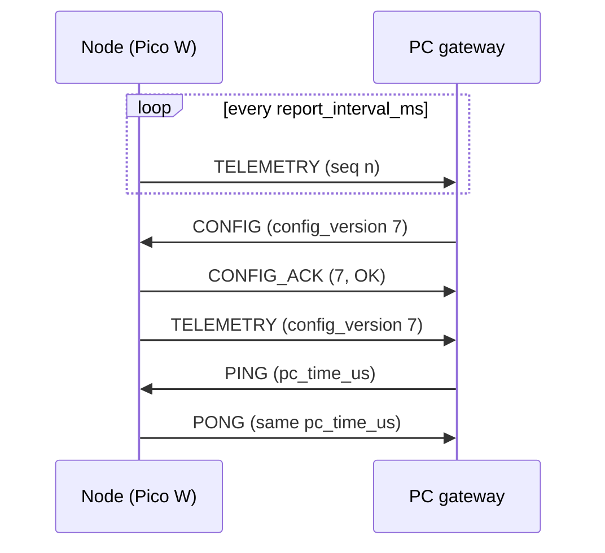

# MOSAIC Wire Protocol (v1, draft)

> **Status: DRAFT for review by Arif and ZhiHao.** Open questions are listed at the end.
> Once agreed, any change needs a PR that updates all three files together and bumps the version.

| What | Where |
|------|-------|
| This specification | `docs/protocol.md` |
| C definitions (nodes) | `firmware/common/include/mosaic_protocol.h`: link `mosaic_common` in CMake |
| Python definitions (PC) | `pc/mosaic/protocol.py` |
| Cross-check tests | `pc/tests/test_protocol.py`: decodes packets built by the C header |

## 1. Overview

Each sensing node sends one **TELEMETRY** datagram per report interval (default 1 s) to the PC.
The PC can send a **CONFIG** to change a node's parameters, and the node replies with a
**CONFIG_ACK**. **PING/PONG** measure round-trip latency for evaluation.

## 2. Transport

| Item | Value |
|------|-------|
| Protocol | UDP over IPv4, Wi-Fi |
| PC listens on | **5005**: TELEMETRY, CONFIG_ACK, PONG |
| Node listens on | **5006**: CONFIG, PING |
| Byte order | Little-endian (native on RP2040 and PCs) |
| Max datagram | 128 bytes (largest is TELEMETRY, 56 bytes) |
| Node → PC address | PC's IP, compiled into node firmware (see open question Q1) |
| PC → node address | The source IP of that node's most recent datagram |

**Why UDP:** telemetry is periodic and each packet supersedes the last, so retransmitting an old
reading is pointless. UDP keeps the node simple, and the sequence numbers make loss measurable
(an evaluation metric). The one message that must arrive, CONFIG, gets its reliability from the
ACK and retry scheme in §5.

**Why fixed binary structs instead of JSON/text:** no parser or string formatting on the node,
fixed and predictable size and timing, and both sides share one definition with compile-time
layout checks. The trade-off is that packets aren't human-readable; the PC gateway decodes and
logs them instead.

## 3. Common header (16 bytes)

Every datagram starts with this header, followed by exactly one payload.

| Offset | Field | Type | Description |
|-------:|-------|------|-------------|
| 0 | `magic` | u16 | `0x534D`: bytes `4D 53` = "MS" |
| 2 | `version` | u8 | `1` |
| 3 | `msg_type` | u8 | 1 TELEMETRY, 2 CONFIG, 3 CONFIG_ACK, 4 PING, 5 PONG |
| 4 | `node_id` | u8 | 1–8 when sent by a node; 0 when sent by the PC |
| 5 | `flags` | u8 | bit 0 `FIRST_SINCE_BOOT`: first TELEMETRY after a reset |
| 6 | `payload_len` | u16 | Must equal the payload size for `msg_type` |
| 8 | `seq` | u32 | Per sender, +1 for every datagram sent; starts at 0 on boot |
| 12 | `sender_time_ms` | u32 | Sender's ms-since-boot clock. **Not synchronised** between devices |

**Receivers drop** any datagram whose magic, version or type is unknown, or whose length doesn't
equal 16 + the payload size for its type. The PC counts drops per node.

## 4. Messages

### TELEMETRY: node → PC (40-byte payload, 56 total)

| Offset | Field | Type | Description |
|-------:|-------|------|-------------|
| 0 | `temperature_c` | f32 | DHT22, °C |
| 4 | `humidity_pct` | f32 | DHT22, %RH |
| 8 | `audio_rms` | f32 | Mean RMS of the last classification window (ADC units) |
| 12 | `dsp_time_us` | u32 | Feature-extraction time for that window |
| 16 | `inference_time_us` | u32 | ML inference time for that window |
| 20 | `free_heap_bytes` | u32 | Free heap (FreeRTOS `xPortGetFreeHeapSize()` once on RTOS) |
| 24 | `co2_ppm` | u16 | ACD1100 reading |
| 26 | `config_version` | u16 | Config currently applied; 0 = compiled-in defaults |
| 28 | `audio_overruns` | u16 | Audio windows dropped since boot |
| 30 | `audio_class` | u8 | 0 UNKNOWN, 1 BACKGROUND_NOISE, 2 LECTURER_SPEECH, 3 STUDENT_CONVERSATION, 4 TRANSIENT_NOISE |
| 31 | `pir_active_pct` | u8 | % of PIR samples showing motion during this interval |
| 32 | `audio_prob_pct[4]` | u8 ×4 | Probability of classes 1–4, 0–100 (index = class − 1) |
| 36 | `valid_flags` | u8 | See below |
| 37 | `cpu_load_pct` | u8 | |
| 38 | `wifi_rssi_dbm` | i8 | Wi-Fi signal strength |
| 39 | `reserved` | u8 | Send 0 |

`valid_flags`: a value is only meaningful when its bit is set.

| Bit | Name | Meaning |
|----:|------|---------|
| 0 | `TEMP_HUM` | DHT22 read and checksum OK |
| 1 | `CO2` | CO₂ reading is current |
| 2 | `CO2_WARMUP` | CO₂ sensor still warming up (2 minutes after power-on) |
| 3 | `PIR` | PIR sampled |
| 4 | `AUDIO` | `audio_class`, `audio_prob_pct` and `audio_rms` are valid |

**Audio class rule:** the node reports the highest-probability class, or `UNKNOWN` if that
probability is below `audio_conf_threshold_pct`. All four probabilities are always sent, so the
PC can smooth them over time. *Sustained chatter* is deliberately **not** an audio class: it's
`STUDENT_CONVERSATION` persisting over time, which the PC fusion engine detects.

### CONFIG: PC → node (16-byte payload, 32 total)

A **complete snapshot** of the node's parameters, not a delta. Applying the same CONFIG twice
is harmless, which makes retries safe.

| Offset | Field | Type | Default | Accepted range |
|-------:|-------|------|--------:|----------------|
| 0 | `config_version` | u16 | (0) | 1–65535; set by the PC, increases on every change |
| 2 | `report_interval_ms` | u16 | 1000 | 200–10000 |
| 4 | `dht_interval_ms` | u16 | 2500 | 2000–60000 (DHT22 minimum is 2 s) |
| 6 | `co2_interval_ms` | u16 | 2000 | 1000–60000 |
| 8 | `audio_gain` | f32 | 1.0 | 0.1–10.0 |
| 12 | `mode` | u8 | 0 | 0 LECTURE, 1 DISCUSSION, 2 QUIET_WORK |
| 13 | `audio_conf_threshold_pct` | u8 | 60 | 0–100 |
| 14 | `reserved[2]` | u8 ×2 | | Send 0 |

If **any** field is out of range the node applies **nothing** and replies `INVALID_VALUE`.

**What is *not* in CONFIG:** fusion thresholds (CO₂ warning level, noise persistence,
state-transition timing) and the node → zone mapping. These live on the PC, so tuning them
never involves the nodes.

### CONFIG_ACK: node → PC (4-byte payload, 20 total)

| Offset | Field | Type | Description |
|-------:|-------|------|-------------|
| 0 | `config_version` | u16 | Echo of the CONFIG being answered |
| 2 | `status` | u8 | 0 OK, 1 INVALID_VALUE (nothing applied), 2 UNSUPPORTED |
| 3 | `reserved` | u8 | Send 0 |

### PING (PC → node) / PONG (node → PC): 8-byte payload, 24 total

| Offset | Field | Type | Description |
|-------:|-------|------|-------------|
| 0 | `pc_time_us` | u64 | Set by the PC; the node copies it unchanged into the PONG |

## 5. Behaviour

### Configuration delivery
1. The PC sends CONFIG and **retries every 500 ms, up to 5 times**, until a CONFIG_ACK with
   the same `config_version` arrives.
2. The node validates the CONFIG (`mosaic_config_check()`), applies it if valid, and **always**
   replies with an ACK, including when it receives a duplicate.
3. **Self-healing:** every TELEMETRY carries `config_version`. If it doesn't match what the PC
   last sent (for example, the node rebooted and is back on defaults, version 0), the PC
   re-sends the CONFIG automatically.

### Latency measurement
The node and PC clocks aren't synchronised, so one-way latency can't be read off timestamps.
The PC sends a PING (e.g. every 5 s), and **round-trip time** = PC time when the PONG arrives −
`pc_time_us`. One-way latency is estimated as RTT / 2.

### PC-side liveness and loss tracking
- **Packet loss** per node = gaps in `seq`. A `seq` that goes backwards, or the
  `FIRST_SINCE_BOOT` flag, means the node rebooted: reset its counters, don't count it as loss.
- **Node status:** `STALE` after 3 × `report_interval_ms` without TELEMETRY, `OFFLINE` after
  10 s. Fusion ignores OFFLINE nodes and lowers its confidence while any are STALE.

### Node-side rules
- **Receiving:** `memcpy` the datagram into the packet struct. **Never cast the raw buffer
  pointer.** lwIP buffers may be unaligned, and unaligned access hard-faults on the Cortex-M0+.
- **Before sending:** zero the struct (`memset`) so reserved bytes are 0.
- `seq` increments for every datagram the node sends (TELEMETRY, CONFIG_ACK, PONG).

## 6. Changing the protocol

1. Open a PR that changes `mosaic_protocol.h`, `protocol.py`, this document **and**
   `MOSAIC_PROTOCOL_VERSION` / `PROTOCOL_VERSION`, all together.
2. Tag Arif and ZhiHao, plus whoever produces or consumes the changed field.
3. CI runs `pc/tests/test_protocol.py`, which compiles the C header and checks Python decodes
   its packets byte for byte. A mismatch fails the PR.

## 7. Open questions for review

| # | Question | Proposal |
|---|----------|----------|
| Q1 | How does a node find the PC? | Phase 1: PC IP compiled in (`#define`). Later: node broadcasts until the PC replies. |
| Q2 | How is `node_id` assigned? | A `#define` per build, or a lookup table from the Pico's unique board ID, so one firmware fits all nodes. |
| Q3 | Audio classes: are these 4 final? | Matches Darius's current labels. Needs Darius's confirmation before the model is deployed. |
| Q4 | Should CO₂ trend (ppm/min) be computed on the node? | Proposed: on the PC, from the received history. Kendrick may prefer the node. |
| Q5 | Is 1 s the right default report interval? | Two 500 ms audio windows fit in one report; the node sends the latest result and the PC smooths over time. |
| Q6 | Is anything else needed on the dashboard (e.g. sound level in dB)? | Add it now, while the protocol is still a draft. |
