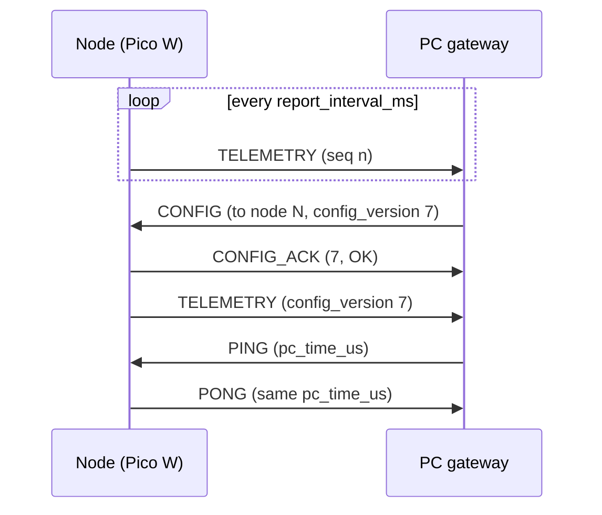

# MOSAIC Wire Protocol (v2)

> **Status: v2 draft, awaiting Arif's review.** v1 was agreed by Arif and ZhiHao on 9 Oct 2026.
> v2 makes the wire integer-only for the fixed-point change requirement and acts on the Week 6
> design feedback (§8). Two questions remain open for Darius and Kendrick (§7).
> Any change needs a PR that updates all three files together and bumps the version (§6).

| What | Where |
|------|-------|
| This specification | `docs/protocol.md` |
| C definitions (nodes) | `firmware/common/include/mosaic_protocol.h`: link `mosaic_common` in CMake |
| Python definitions (PC) | `pc/mosaic/protocol.py` |
| Cross-check tests | `pc/tests/test_protocol.py`: decodes packets built by the C header |

## 1. Overview

Each sensing node sends one **TELEMETRY** datagram per report interval (default 1 s) to the PC.
The PC can send a **CONFIG** to change a node's parameters, and the node replies with a
**CONFIG_ACK**. **PING/PONG** measure round-trip latency for evaluation.

## 2. Transport

| Item | Value |
|------|-------|
| Protocol | UDP over IPv4, Wi-Fi |
| PC listens on | **5005**: TELEMETRY, CONFIG_ACK, PONG |
| Node listens on | **5006**: CONFIG, PING |
| Byte order | Little-endian (native on RP2040 and PCs) |
| Max datagram | 128 bytes (largest is TELEMETRY, 64 bytes) |
| Numbers | Integers only. Fractions are scaled integers; the suffix gives the scale (`_x10` = tenths, `_x16` = Q12.4, `_x256` = Q8.8) |
| Node → PC address | PC's IP, compiled into node firmware as `MOSAIC_PC_IP` (decision D1) |
| PC → node address | The source IP of that node's most recent datagram |

### Over MQTT (the micro T-Kernel node)

The micro T-Kernel node can't send its own datagrams (the course template keeps all
networking inside its Wi-Fi task), so it reaches the PC through an MQTT broker
(decision log, 16 Nov). The packets themselves don't change: each MQTT message carries
exactly one protocol v2 packet as its payload, bytes as above.

| Topic | Direction | Carries | QoS | Retained |
|---|---|---|---|---|
| `mosaic/node/<id>/telemetry` | node → PC | every packet the node sends: TELEMETRY, PONG, CONFIG_ACK | 0 | no |
| `mosaic/node/<id>/config` | PC → node | CONFIG | 1 | yes |
| `mosaic/node/<id>/config` | PC → node | PING | 0 | no |
| `mosaic/node/<id>/status` | node (last will) | `online` when it connects, `offline` from the broker when its connection drops | 1 | yes |

`<id>` is the node ID in decimal (`1`..`8`). The PC drops a packet whose header node ID
differs from the topic's, so a node can only speak for itself. Retaining CONFIG means a node
that reconnects gets its configuration back without waiting for the PC; the node still
answers with CONFIG_ACK, because MQTT's own acknowledgement only shows the broker received it.
Telemetry stays at QoS 0: the sequence numbers already count losses, and a resent old reading
is no use. With MQTT, PING round-trip times include two hops through the broker.

PC side: `pc/mosaic/mqtt.py` (standard library only) and `--mqtt HOST[:PORT]` on the gateway,
dashboard and simulator. UDP stays available for the original firmware.

**Why UDP:** telemetry is periodic and each packet supersedes the last, so retransmitting an old
reading is pointless. UDP keeps the node simple, and the sequence numbers make loss measurable
(an evaluation metric). The one message that must arrive, CONFIG, gets its reliability from the
ACK and retry scheme in §5.

**Why integers only:** the RP2040 has no FPU, and the CSC21 change requirement removes floating
point from the application paths. Sending the node's own fixed-point values means the node never
converts to float just to transmit. The PC converts for display (`Telemetry.temperature_c` etc.).

**Why fixed binary structs instead of JSON/text:** no parser or string formatting on the node,
fixed and predictable size and timing, and both sides share one definition with compile-time
layout checks. The trade-off is that packets aren't human-readable; the PC gateway decodes and
logs them instead.

## 3. Common header (16 bytes)

Every datagram starts with this header, followed by exactly one payload.

| Offset | Field | Type | Description |
|-------:|-------|------|-------------|
| 0 | `magic` | u16 | `0x534D`: bytes `4D 53` = "MS" |
| 2 | `version` | u8 | `2`. A v1 datagram is dropped |
| 3 | `msg_type` | u8 | 1 TELEMETRY, 2 CONFIG, 3 CONFIG_ACK, 4 PING, 5 PONG |
| 4 | `node_id` | u8 | 1–8. Node → PC: the sender (`MOSAIC_NODE_ID`, set per build). PC → node: the **destination**; a node ignores messages for another ID |
| 5 | `flags` | u8 | bit 0 `FIRST_SINCE_BOOT`: first TELEMETRY after a reset |
| 6 | `payload_len` | u16 | Must equal the payload size for `msg_type` |
| 8 | `seq` | u32 | Per sender, +1 for every datagram sent; starts at 0 on boot |
| 12 | `sender_time_ms` | u32 | Sender's ms-since-boot clock. **Not synchronised** between devices |

**Receivers drop** any datagram whose magic, version or type is unknown, or whose length doesn't
equal 16 + the payload size for its type. The PC counts drops per node.

## 4. Messages

### TELEMETRY: node → PC (48-byte payload, 64 total)

| Offset | Field | Type | Description |
|-------:|-------|------|-------------|
| 0 | `dsp_time_us` | u32 | **Longest** feature-extraction time of the windows in this interval |
| 4 | `inference_time_us` | u32 | **Longest** ML inference time of the windows in this interval |
| 8 | `free_heap_bytes` | u32 | Free heap. Sent as 0 by the µT-Kernel node: no task fills it |
| 12 | `temperature_x10` | i16 | DHT22, 0.1 °C (`-55` = −5.5 °C) |
| 14 | `humidity_x10` | u16 | DHT22, 0.1 %RH |
| 16 | `co2_ppm` | u16 | ACD1100 reading |
| 18 | `config_version` | u16 | Config currently applied; 0 = compiled-in defaults |
| 20 | `audio_overruns` | u16 | Audio windows dropped since boot (sampling could not keep up) |
| 22 | `audio_window_seq` | u16 | Number of the newest window in `audio[]`; +1 per classified window, wraps |
| 24 | `audio[2]` | 2 × audio window | Windows classified since the last report, **oldest first** |
| 40 | `audio_window_count` | u8 | Valid entries in `audio[]`, 0–2. Unused entries are all 0 |
| 41 | `pir_active_pct` | u8 | % of PIR samples showing motion during this interval |
| 42 | `valid_flags` | u8 | See below |
| 43 | `cpu_load_pct` | u8 | Sent as 0 by the µT-Kernel node: no task fills it |
| 44 | `wifi_rssi_dbm` | i8 | Wi-Fi signal strength. Sent as 0 by the µT-Kernel node: no task fills it |
| 45 | `reserved[3]` | u8 ×3 | Send 0 |

**Audio window** (8 bytes, `mosaic_audio_window_t`):

| Offset | Field | Type | Description |
|-------:|-------|------|-------------|
| 0 | `rms_x16` | u16 | Mean RMS of the 500 ms window in ADC units, Q12.4 (`200` = 12.5) |
| 2 | `audio_class` | u8 | 0 UNKNOWN, 1 BACKGROUND_NOISE, 2 SPEECH, 3 RESERVED (never report), 4 TRANSIENT_NOISE |
| 3 | `prob_pct[4]` | u8 ×4 | Background, speech, reserved (must be 0), transient; 0–100 (index = class − 1) |
| 7 | `reserved` | u8 | Send 0 |

`valid_flags`: a value is only meaningful when its bit is set.

| Bit | Name | Meaning |
|----:|------|---------|
| 0 | `TEMP_HUM` | DHT22 read and checksum OK |
| 1 | `CO2` | CO₂ reading is current |
| 2 | `CO2_WARMUP` | CO₂ sensor still warming up (2 minutes after power-on) |
| 3 | `PIR` | PIR sampled. `pir_active_pct` measures **motion**, not presence: a seated, still class reads low |
| 4 | — | Was `AUDIO` in v1. Audio is valid when `audio_window_count` > 0 |

**Why two audio windows:** a window is 500 ms and the default report is 1 s, so each report
covers two windows. v1 sent only the latest result and silently discarded the other half (Week 6
feedback). With the default interval the node now sends every classification. If a CONFIG sets a
longer interval, the node sends the two newest windows, and the PC counts the rest as skipped
from `audio_window_seq` (§5).

**Audio class rule:** for each window the node reports the highest-probability active class
(1, 2 or 4), or `UNKNOWN` if that probability is below `audio_conf_threshold_pct`.
For the classifier's background, speech and transient outputs, send
`[background, speech, 0, transient]`. The four slots, window size and v2 version are unchanged.
Slot 3 (`prob_pct[2]`) must be zero. The PC rejects the entire TELEMETRY datagram if
any declared audio window has a nonzero slot 3 or reports `audio_class = 3`. Update old
senders that used slot 3 before pairing them with the updated receiver.

The audio model does not identify the speaker. The PC interprets speech at the configured
lecturer/reference zone as lecturer speech. For student zones it uses a calibrated level
comparison when available (after voice setup). Without it, the PC falls back to the `SPEECH`
probability plus a loudness check: while the lecturer zone is speaking, student-zone speech
counts as local talk only if its mean `rms_x16` reaches `uncalibrated_local_rms_pct` (75 %)
of the lecturer zone's, because every node hears the lecturer as speech, only quieter.
**Limit:** a student talking close to a node while the lecturer is far from the reference node
can still be misattributed; voice setup is recommended. Sustained chatter is a PC fusion
state, not an audio class.

### CONFIG: PC → node (16-byte payload, 32 total)

A **complete snapshot** of the node's parameters, not a delta. Applying the same CONFIG twice
is harmless, which makes retries safe. The header's `node_id` is the destination node.

| Offset | Field | Type | Default | Accepted range |
|-------:|-------|------|--------:|----------------|
| 0 | `config_version` | u16 | (0) | 1–65535; set by the PC, increases on every change |
| 2 | `report_interval_ms` | u16 | 1000 | 200–10000 |
| 4 | `dht_interval_ms` | u16 | 2500 | 2000–60000 (DHT22 minimum is 2 s) |
| 6 | `co2_interval_ms` | u16 | 2000 | 1000–60000 |
| 8 | `audio_gain_x256` | u16 | 256 (1.0) | 26–2560 (0.1–10.0). Q8.8 sample multiplier |
| 10 | `mode` | u8 | 0 | 0 LECTURE, 1 DISCUSSION, 2 QUIET_WORK |
| 11 | `audio_conf_threshold_pct` | u8 | 60 | 0–100 |
| 12 | `reserved[4]` | u8 ×4 | | Send 0 |

If `config_version` is **older** than the one the node has applied, it applies nothing and
replies `STALE_VERSION`. Otherwise, if **any** field is out of range, it applies nothing and
replies `INVALID_VALUE`. The same version again is a retry and is accepted.

**What is *not* in CONFIG:** fusion thresholds (CO₂ warning level, noise persistence,
state-transition timing) and the node → zone mapping. These live on the PC, so tuning them
never involves the nodes.

### CONFIG_ACK: node → PC (4-byte payload, 20 total)

| Offset | Field | Type | Description |
|-------:|-------|------|-------------|
| 0 | `config_version` | u16 | Echo of the CONFIG being answered |
| 2 | `status` | u8 | 0 OK, 1 INVALID_VALUE (nothing applied), 2 UNSUPPORTED, 3 STALE_VERSION (nothing applied) |
| 3 | `reserved` | u8 | Send 0 |

### PING (PC → node) / PONG (node → PC): 8-byte payload, 24 total

| Offset | Field | Type | Description |
|-------:|-------|------|-------------|
| 0 | `pc_time_us` | u64 | Set by the PC; the node copies it unchanged into the PONG |

## 5. Behaviour

### Configuration delivery
1. The PC sends CONFIG and **retries every 500 ms, up to 5 times**, until a CONFIG_ACK with
   the same `config_version` arrives.
2. The node validates the CONFIG (`mosaic_config_check(&config, current_version)`), applies it if
   valid, and **always** replies with an ACK, including when it receives a duplicate.
3. **Self-healing:** every TELEMETRY carries `config_version`. If it doesn't match what the PC
   last sent (for example, the node rebooted and is back on defaults, version 0), the PC
   re-sends the CONFIG automatically.
4. **PC restarts:** `config_version` only moves forward, so a delayed or replayed CONFIG can't roll
   a node back. If the PC restarts and starts counting from 1 again, the node answers
   `STALE_VERSION`; the PC then re-sends with the node's reported `config_version` + 1.

### Latency measurement
The node and PC clocks aren't synchronised, so one-way latency can't be read off timestamps.
The PC sends a PING (e.g. every 5 s), and **round-trip time** = PC time when the PONG arrives −
`pc_time_us`. One-way latency is estimated as RTT / 2.

### Audio windows
- **Skipped windows** = (`audio_window_seq` − previous `audio_window_seq`) mod 65536 −
  `audio_window_count`. It's 0 at the default 1 s interval. A lost TELEMETRY also shows up here
  (its windows never arrived); the `seq` gap tells the two causes apart.
- `audio_overruns` counts windows the node itself failed to process in time, so DSP overload and
  network loss can be told apart.

### PC-side liveness and loss tracking
- **Unique-message loss** per node = sequence gaps still unrecovered. The node
  sends up to two extra TELEMETRY copies (first due after 100 ms, second at least
  200 ms later); copies retain the original sequence, timestamp and payload.
  They expire after 600 ms and occupy at most four fixed node-side slots.
  This adds no message types or bytes to the v2 layout. Update the gateway and
  node together: older gateways do not safely handle delayed duplicate copies.
- The PC tracks 256 sequence positions. A late arrival can repair a tracked
  gap; duplicates are counted separately and do not inflate `received`, refresh
  liveness, or enter fusion. Recovered older telemetry is saved in CSV but cannot
  overwrite newer live data. PONG alone does not keep old telemetry fresh.
- `gaps_detected` and `recovered` remain visible separately. A lower residual
  loss after retries demonstrates recovered data, **not** improved raw Wi-Fi
  transmission reliability. Keep raw-capture results and the original failed
  N10 result; do not claim the original raw-loss target passed from this metric.
- Backwards sequence numbers alone do not mean a reboot. Use the boot flag
  (allowing its short-lived retry copies) or a backwards sequence corroborated
  by sender-clock rollback near boot. Without a unique boot ID the legacy v2
  header cannot perfectly distinguish arbitrary old-session replay from reboot.
  Retain lifetime counters; reset bounded sequence history after a reboot.
- **Node status:** `STALE` after 3 × `report_interval_ms` without TELEMETRY, `OFFLINE` after
  10 s. Fusion ignores OFFLINE nodes and lowers its confidence while any are STALE.

### Node-side rules
- **Who to listen to:** accept CONFIG and PING only when the source IP is `MOSAIC_PC_IP` and the
  header `node_id` is this node's `MOSAIC_NODE_ID`. Anything else is dropped without a reply. This
  stops another device on the classroom network from reconfiguring a node by accident or on
  purpose. It isn't authentication (an IP can be spoofed); a shared-key MAC is deferred (§8).
- **Receiving:** `memcpy` the datagram into the packet struct. **Never cast the raw buffer
  pointer.** lwIP buffers may be unaligned, and unaligned access hard-faults on the Cortex-M0+.
- **Before sending:** zero the struct (`memset`) so reserved bytes are 0.
- `seq` increments for each new message (TELEMETRY, CONFIG_ACK, PONG). A bounded
  TELEMETRY retry reuses its original `seq` and bytes, and never advances it.

## 6. Changing the protocol

1. Open a PR that changes `mosaic_protocol.h`, `protocol.py`, this document **and**
   `MOSAIC_PROTOCOL_VERSION` / `PROTOCOL_VERSION`, all together.
2. Tag Arif and ZhiHao, plus whoever produces or consumes the changed field.
3. CI runs `pc/tests/test_protocol.py`, which compiles the C header and checks Python decodes
   its packets byte for byte. A mismatch fails the PR.

## 7. Decisions and open questions

### Agreed

| # | Decision | Agreed by |
|---|----------|-----------|
| D1 | **Finding the PC:** the PC's IP is compiled into the node firmware (`MOSAIC_PC_IP`). Discovery by broadcast may be added later if needed. | Arif, ZhiHao |
| D2 | **Node IDs:** set per build with `MOSAIC_NODE_ID` (1–8), e.g. `-DMOSAIC_NODE_ID=3` in the node's CMake target. Each physical node is flashed with its own ID. | Arif, ZhiHao |
| D3 | **Report interval:** 1 s default. Two 500 ms audio windows fit in one report; the node sends the latest result and the PC smooths over time. | Arif, ZhiHao |
| D4 | **Packet contents:** the TELEMETRY fields above are sufficient for now. | Arif, ZhiHao |
| D5 | **v2, integers only:** scaled integers replace every float (§2). | ZhiHao; *Arif to confirm* |
| D6 | **Every audio window is reported:** up to 2 per TELEMETRY plus `audio_window_seq`. Replaces the latest-only rule in D3. | ZhiHao; *Arif to confirm* |
| D7 | **CONFIG/PING checks:** source IP, destination `node_id`, and versions that never go backwards. | ZhiHao; *Arif to confirm* |

### Still open

| # | Question | Owner | Current default |
|---|----------|-------|-----------------|
| Q3 | Are the 4 audio classes final? | Darius | Matches the current training labels. Changing them changes `mosaic_audio_class_t` and needs a version bump. |
| Q4 | Should CO₂ trend (ppm/min) be computed on the node? | Kendrick | Computed on the PC from the received history; no packet change needed. |

## 8. Changes from v1

| Change | Why |
|--------|-----|
| `temperature_c`, `humidity_pct` (f32) → `temperature_x10` (i16), `humidity_x10` (u16) | Fixed-point change requirement. These are the DHT22's own units and Kendrick's `environment_record_t`, so the node sends them unchanged |
| `audio_rms` (f32) → per-window `rms_x16` (Q12.4) | Fixed-point change requirement. A 12-bit ADC RMS fits Q12.4 in 16 bits |
| `audio_class` + `audio_prob_pct` → `audio[2]` + `audio_window_count` + `audio_window_seq` | v1 discarded every second window (Week 6 feedback) |
| `VALID_AUDIO` flag removed | Replaced by `audio_window_count` |
| `dsp_time_us`, `inference_time_us`: last window → longest window in the interval | The deadline is about the worst case |
| CONFIG `audio_gain` (f32) → `audio_gain_x256` (Q8.8) | Fixed-point change requirement; validated with integer compares |
| PC → node `node_id` = destination; node checks source IP and `node_id` | CONFIG was accepted from any sender (Week 6 feedback) |
| New ACK status `STALE_VERSION` | Old or replayed CONFIGs can't roll a node back |
| PC sends one PING per node instead of per IP | Follows from destination `node_id` |

**Deferred:** a shared-key MAC (e.g. truncated HMAC) on CONFIG. The source and version checks are
enough for a classroom prototype; adding a MAC later is a v3 change.
